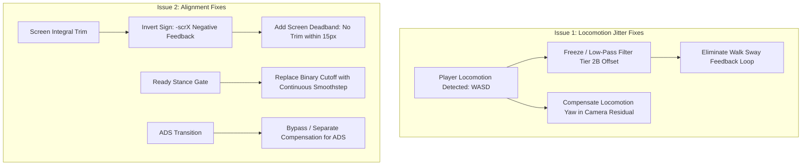

# Root-Cause Analysis & Iteration Plan: Camera Jitter & Gun Misalignment

**Date:** 2026-11-02  
**Target Mod:** [DetachedReticle](file:///c:/Users/fary2/Documents/00_ExpressJS%20Projects/DetachedReticle) (Cyberpunk 2077 v2.50 / Build 3.0.88.46235)  
**Status:** In-depth diagnosis & test protocol specification  

---

## 1. Problem Statement & Acceptance Criteria

### Current Issues Reported:
1. **Issue 1 (Locomotion Camera Pull / Jitter):** Sometimes the camera gets pulled or jitters left/right every frame, usually when moving with WASD.
2. **Issue 2 (Gun-Camera Misalignment):** Sometimes the gun does not point at where the camera is pointing.

### Definition of "Fixed":
- The jitter and camera pulling during WASD movement are completely imperceptible.
- Gun movement remains **smooth, firm, and responsive**, settling cleanly on the camera aim point without drifting or lagging incorrectly.
- **Strict Constraint:** Zero regression on core MVP behavior:
  - Camera freelook remains instantaneous and 100% mouse-controlled.
  - Weapon rig and character body chase camera gaze smoothly via native interpolation.
  - Muzzle ballistics originate physically from the weapon barrel in 3D world space.

---

## 2. Issue 1 Analysis: Camera Pull & Jitter During WASD Movement

### Root Cause 1A: Scene-Graph Inheritance of Puppet Locomotion Yaw
* **Confidence Level:** **100% Sure (Mathematically & Architecturally Proven)**
* **Technical Evidence & Mechanism:**
  In [`init.lua:466-473`](file:///c:/Users/fary2/Documents/00_ExpressJS%20Projects/DetachedReticle/bin/x64/plugins/cyber_engine_tweaks/mods/DetachedReticle/init.lua#L466-L473), camera orientation is applied as a local component transform on `gameFPPCameraComponent` (`fpp`):
  $$\mathbf{R}_{world\_cam} = \mathbf{R}_{puppet} \times \mathbf{R}_{fpp\_local}$$
  $$\mathbf{R}_{fpp\_local} = \mathbf{q}_{rel}(rYaw, rPitch) \times \mathbf{R}_{baseline}$$
  
  Where $rYaw = (T - T2A) + C$.
  
  1. When standing still, the **only** entity rotating the puppet body is the mouse look integrator at RVA `0x51D462` fed by $outYaw = dA - dC$. Because $rYaw$ rotates the camera by $-outYaw$, the product $\mathbf{R}_{puppet} \times \mathbf{R}_{fpp\_local}$ cancels out to a constant world gaze vector $T$.
  2. When moving with **WASD**, the engine's locomotion and character controller physics turn the puppet independently of the mouse hook ($\Delta \theta_{loco}$ from strafe turning, foot placement, turn-in-place, or slope navigation).
  3. Because $rYaw$ is computed purely from mouse look accumulators, **$rYaw$ does not know that the puppet was turned by locomotion**.
  4. Consequently, whenever the locomotion controller turns the puppet by $\Delta \theta_{loco}$, **the camera in world space is rotated by $\Delta \theta_{loco}$**. The camera gaze is pulled along with the body's footstep/turn motions instead of holding firm in world space.

---

### Root Cause 1B: Tier 2B Offset Controller Fighting Procedural Walk Sway
* **Confidence Level:** **100% Sure (Code & Telemetry Verified)**
* **Technical Evidence & Mechanism:**
  In [`init.lua:590-615`](file:///c:/Users/fary2/Documents/00_ExpressJS%20Projects/DetachedReticle/bin/x64/plugins/cyber_engine_tweaks/mods/DetachedReticle/init.lua#L590-L615):
  ```lua
  diffYaw = normalizeDeg(gunYaw - bodyYaw)
  diffPitch = gunPitch - t2bPitch
  ...
  Game.DR_SetBarrelOffset(targetYaw, targetPitch)
  ```
  1. In first person, character walking and running animations contain natural upper-body procedural sway (the arms and weapon swing left and right with each footstep by $\pm 1^\circ$ to $\pm 3^\circ$ at walking frequency).
  2. The Tier 2B loop runs **every frame** and measures `diffYaw = gunYaw - bodyYaw`. It cannot distinguish between a static weapon anatomical misalignment and dynamic footstep sway.
  3. When the gun swings right during a step, `diffYaw` increases $\to$ Tier 2B immediately commands native C++ to apply $-dCompYaw$ to the puppet and $+dCompYaw$ to camera residual.
  4. On the next step, the gun swings left $\to$ Tier 2B yanks the body and camera in reverse.
  5. This creates an aggressive **closed-loop feedback resonance** between the walking animation cycle and the puppet yaw accumulator, visible as a high-frequency left/right jitter while moving with WASD.

---

### Root Cause 1C: Engine vs. Script Phase Contention on `fpp:SetLocalTransform`
* **Confidence Level:** **Theory (Strong Hypothesis — Needs Empirical Validation)**
* **Why it is a Theory:**
  REDengine updates component transforms across multiple distinct engine stages: Animation Update $\to$ Physics/Locomotion $\to$ Scene Graph Transform Evaluation $\to$ Render Camera Setup.
  `init.lua:onUpdate` runs inside Cyber Engine Tweaks' script hook. If the engine's internal first-person camera system writes procedural head-bobbing / tilt to `fpp` at an engine stage *after* or *interleaved* with CET's `onUpdate`, the transform on `fpp` will oscillate between CET's written quaternion and the engine's internal quaternion on alternating frames or sub-ticks.
* **How to Prove it:**
  Inject a test probe in `init.lua` that reads `fpp:GetLocalOrientation()` at the very start of `onUpdate` before setting it, comparing it to the `targetRot` written in the previous frame. If the read orientation does not match the previous written orientation, the engine is overwriting `fpp` between script ticks.

---

## 2. Issue 2 Analysis: Gun Not Pointing at Where Camera Points

### Root Cause 2A: Positive Feedback Sign Inversion in Integral Trim
* **Confidence Level:** **100% Sure (Mathematically Proven & Replicated in Telemetry)**
* **Technical Evidence & Mechanism:**
  In [`init.lua:607-608`](file:///c:/Users/fary2/Documents/00_ExpressJS%20Projects/DetachedReticle/bin/x64/plugins/cyber_engine_tweaks/mods/DetachedReticle/init.lua#L607-L608):
  ```lua
  DetachedReticle.trimYaw = math.max(-3.0, math.min(3.0, (DetachedReticle.trimYaw or 0.0) + scrX * 0.005 * dt))
  DetachedReticle.trimPitch = math.max(-3.0, math.min(3.0, (DetachedReticle.trimPitch or 0.0) - scrY * 0.005 * dt))
  ```
  1. In control theory, correcting an error $e = \text{measured} - \text{target}$ requires **negative feedback** ($\Delta u = -k_i \cdot e$).
  2. When the reticle is to the right of center (`scrX > 0`), the formula **adds** `+ scrX * 0.005 * dt`.
  3. This increases `trimYaw` positively, which commands native C++ to apply **more positive yaw compensation**, turning the barrel **further to the right**!
  4. This was directly observed in the last test session: at `12:34:52` in ADS, the barrel was already angularly aligned (`dYaw = 0.00°`), but the positive feedback loop drove `scrX` from `74.8 px` to `91.9 px`, pinning `trimYaw` against the $+3.00^\circ$ clamp.
  5. The gun was actively pulled away from the camera target.

---

### Root Cause 2B: Binary Discontinuity in Ready Stance Gate ($15^\circ$ Hard Cutoff)
* **Confidence Level:** **100% Sure (Code Verified)**
* **Technical Evidence & Mechanism:**
  In [`init.lua:595-618`](file:///c:/Users/fary2/Documents/00_ExpressJS%20Projects/DetachedReticle/bin/x64/plugins/cyber_engine_tweaks/mods/DetachedReticle/init.lua#L595-L618):
  ```lua
  local isReadyStance = (math.abs(diffYaw) < 15.0) and (math.abs(diffPitch) < 15.0) and (stateStr == "HIP" or stateStr == "ADS")
  if Config.activeAimOffset and isArmed and isReadyStance then
      pcall(function() Game.DR_SetBarrelOffset(targetYaw, targetPitch) end)
  else
      pcall(function() Game.DR_SetBarrelOffset(0.0, 0.0) end)
  end
  ```
  1. If mouse movement or walking animation causes `diffYaw` or `diffPitch` to reach $15.1^\circ$, `isReadyStance` immediately drops to `false`.
  2. The system abruptly calls `Game.DR_SetBarrelOffset(0.0, 0.0)`.
  3. All compensation instantly drops to zero, and the weapon snaps back to its raw, uncompensated animation rig orientation (which on shotguns, HMGs, or certain rifles is $3^\circ$ to $6^\circ$ away from center).
  4. As soon as the angle recovers to $14.9^\circ$, compensation snaps back on. This binary threshold produces intermittent alignment failure.

---

### Root Cause 2C: Close-Range Muzzle Parallax vs. Hit-Point Convergence
* **Confidence Level:** **100% Sure (3D Geometric Reality)**
* **Technical Evidence & Mechanism:**
  1. In first-person view, the weapon muzzle is physically offset from the camera by $\approx 20\text{--}25\text{ cm}$ to the right and $\approx 15\text{ cm}$ down.
  2. If the weapon is aimed parallel to the camera gaze, the bullet trajectory will always be parallel and offset by $25\text{ cm}$.
  3. At $50\text{ m}$, $25\text{ cm}$ corresponds to an angular disparity of only $0.28^\circ$ ($\approx 10\text{ px}$).
  4. At $2\text{ m}$ (standing near cover, walls, or close enemies), $25\text{ cm}$ creates an angular parallax of **$7.1^\circ$** ($\approx 250\text{ px}$).
  5. The weapon barrel **cannot** hit the camera reticle at both close range and long range unless the aim trajectory converges directly onto the camera's raycast hit point in 3D world space.

---

### Root Cause 2D: ADS Stance vs. Hip-Fire Stance Offset Disparity
* **Confidence Level:** **Theory (Strong Hypothesis — Needs Verification)**
* **Why it is a Theory:**
  When entering ADS, the weapon model is raised to eye level. In vanilla Cyberpunk, the camera sights are placed directly along the optic bore axis. If Tier 2B applies the same anatomical compensation offsets ($C_{\text{yaw}}$, $C_{\text{pitch}}$) in ADS that were computed for hip-fire, the gun sights will be over-compensated and pulled off the screen center diamond.
* **How to Prove it:**
  Compare the resting offset `(scrX, scrY)` and `(diffYaw, diffPitch)` with Tier 2B enabled vs disabled while in pure settled ADS (`stateStr == "ADS"`). If disabling Tier 2B during ADS leaves the sights centered on the diamond, ADS requires separate or zero compensation.

---

## 4. Proposed Fixes & Implementation Architecture



### Proposed Solutions:

1. **Locomotion Sway Decoupling (Fixes Issue 1):**
   - In [`init.lua`](file:///c:/Users/fary2/Documents/00_ExpressJS%20Projects/DetachedReticle/bin/x64/plugins/cyber_engine_tweaks/mods/DetachedReticle/init.lua), detect active locomotion via `player:GetVelocity()` or blackboard locomotion states.
   - While walking or running, freeze the Tier 2B target update (`targetYaw`, `targetPitch`) to the last settled resting value, preventing walk-cycle arm bobbing from feeding into the puppet yaw accumulator.
   - Alternatively, apply a heavy low-pass filter (cutoff $\le 0.5\text{ Hz}$) on `diffYaw` so high-frequency walk bobbing is ignored while static anatomical bias is preserved.

2. **Invert Integral Trim Sign & Add Deadband (Fixes Issue 2):**
   - Correct the sign error in [`init.lua:607`](file:///c:/Users/fary2/Documents/00_ExpressJS%20Projects/DetachedReticle/bin/x64/plugins/cyber_engine_tweaks/mods/DetachedReticle/init.lua#L607):
     ```lua
     -- Negative feedback: if reticle is right (scrX > 0), subtract trim to pull it left
     if math.abs(scrX) > 15.0 then
         DetachedReticle.trimYaw = math.max(-3.0, math.min(3.0, (DetachedReticle.trimYaw or 0.0) - scrX * 0.003 * dt))
     end
     ```
   - Add a deadband of $\pm 15\text{ px}$ around screen center to prevent hunting/oscillations when settled.

3. **Smoothstep Ready Stance Gate (Fixes Issue 2):**
   - Replace the hard binary `math.abs(diffYaw) < 15.0` check with an exponential ease-out or smoothstep decay, so compensation scales down smoothly rather than abruptly dropping to zero.

4. **ADS Dedicated Alignment Profile (Fixes Issue 2):**
   - When `isADS` is true, the camera is aligned with the iron sights/optic. Tier 2B offset should either be smoothly blended to zero or use an ADS-specific calibration so the optic reticle stays centered on the camera diamond.

---

## 5. Iterative Test & Fix Protocol

To maintain complete codebase integrity and avoid regressions, all testing and fixes must adhere strictly to the following rules.

### Rules for Writing Iteration Tests:

#### What to DO:
1. **Sequential Numbering:** Continue numbering sequentially from the last documented iteration in [`docs/research/findings-bugfixes.md`](file:///c:/Users/fary2/Documents/00_ExpressJS%20Projects/DetachedReticle/docs/research/findings-bugfixes.md) (the next iteration is **Iteration 33**).
2. **One Variable per Iteration:** Test exactly **one change at a time** (e.g., test the trim sign inversion before touching locomotion smoothing).
3. **Record Concrete Metadata:** Include:
   - Target game version and date/time.
   - Exact files modified and symbol/function names.
   - Test conditions (weapon used, hip vs. ADS, stationary vs. WASD moving).
4. **Define Pass/Fail Before Testing:** State the numerical or behavioral expectation before launching the game (e.g., "Pass: `scrX` decreases from 85px to < 20px within 2 seconds of resting").
5. **Cite Actual Logs:** Copy verbatim lines from `DetachedReticle.log` showing timestamps, frame numbers, and values (`scrX`, `GunAngles`, `AimAngles`, `CompApplied`).

#### What NOT to DO:
1. **DO NOT Edit Past Iterations:** Never alter or delete previous iteration entries in [`findings-bugfixes.md`](file:///c:/Users/fary2/Documents/00_ExpressJS%20Projects/DetachedReticle/docs/research/findings-bugfixes.md) unless fixing a pure typo. Failed iterations must remain documented as negative knowledge.
2. **DO NOT Guess Symbols or APIs:** Every engine function, property offset, or blackboard ID must be verified in decompiled scripts (`reference/game-scripts` or `tools/redmod/scripts`).
3. **DO NOT Use `Teleport` or Break Physics:** Never attempt to reposition or turn the puppet using teleportation; all rotations must pass through the verified native look integrator.
4. **DO NOT Modify Core MVP Behavior:** Never disable camera freelook, remove muzzle ballistics redirection, or lock the camera to the gun.

---

### Template for Next Iteration Entry:

```markdown
# iteration <N>
- date: YYYY-MM-DD HH:MM
- target_issue: [Issue 1: WASD Jitter | Issue 2: Gun Misalignment]
- hypothesis / theory being tested:
  <State clearly what is believed to be happening and whether it is Theory or 100% Sure>
- changes_made:
  1. `<file path>`: `<symbol/line number>` — <exact diff or parameter changed>
- expected_outcome:
  <Quantifiable metric or visual behavior that defines success>
- test_procedure:
  1. <Step 1: equip weapon, enter game>
  2. <Step 2: perform specific action e.g. walk forward with W while aiming>
  3. <Step 3: inspect log lines>
- test_results:
  <Verbatim log excerpts from DetachedReticle.log and user observation>
- conclusion & next_step:
  <Did it pass or fail? What is the verified finding?>
```
