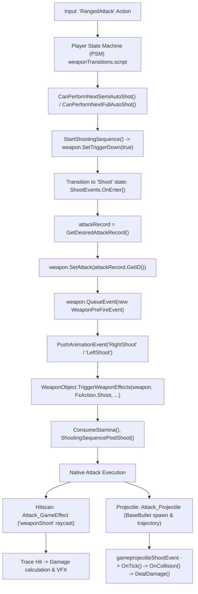

# Cyberpunk 2077 — Weapon Fire & Aim Pipeline Research

**Document Path:** `docs/research/weapon-fire-flow.md`  
**Phase:** Phase 0 — Research (Read-Only)  
**Game Version Reference:** Cyberpunk 2077 2.1x (via REDmod scripts and vanilla tweaks)  
**Authoritative Reference Sources:**
- Vanilla Scripts: `tools/redmod/scripts/` (`cyberpunk/`, `core/`)
- Vanilla Tweaks: `tools/redmod/tweaks/`
- Plugin APIs: `red4ext/plugins/` (`Codeware`, `ArchiveXL`, `TweakXL`)

---

## 1. Executive Summary

This document presents verified findings on Cyberpunk 2077's weapon aiming, firing, ballistic, and reticle pipelines to inform the design and feasibility of the **DetachedReticle** mod (decoupling camera aim from physical weapon orientation).

All claims in this document cite exact file paths and symbol names found directly within the decompiled vanilla codebase and engine bindings.

---

## 2. Call Order: "Fire Pressed" to "Bullet / Hit Exists"

The player weapon firing pipeline is a hybrid state-machine and native engine sequence:



### Detailed Sequence Breakdown

1. **Trigger Input & Conditions:**
   - **File:** [`e:/Cyberpunk 2077/tools/redmod/scripts/cyberpunk/player/psm/weaponTransitions.script`](file:///e:/Cyberpunk%202077/tools/redmod/scripts/cyberpunk/player/psm/weaponTransitions.script#L300)
   - **Method:** `CanPerformNextSemiAutoShot(weaponObject, stateContext, scriptInterface)` (L300) and `CanPerformNextFullAutoShot(...)` (L312).
   - Validates trigger mode (`SemiAuto`, `Burst`, `FullAuto`, `Charge`), magazine status (`!weaponObject.IsMagazineEmpty()`), and sprint/slide state flags.

2. **Sequence Initialization:**
   - **File:** [`e:/Cyberpunk 2077/tools/redmod/scripts/cyberpunk/player/psm/weaponTransitions.script`](file:///e:/Cyberpunk%202077/tools/redmod/scripts/cyberpunk/player/psm/weaponTransitions.script#L187)
   - **Method:** `StartShootingSequence(stateContext, scriptInterface, fireDelay, burstCycleTime, numShotsBurst, ...)` (L187).
   - Sets cycle times, burst parameters, and initiates weapon state:
     - Calls native `GetWeaponObject(scriptInterface).SetTriggerDown(true)` (L200).
     - Calls native `GetWeaponObject(scriptInterface).SetupBurstFireSound(numShotsBurst)` (L201).

3. **PSM Shoot State Entry (`ShootEvents.OnEnter`):**
   - **File:** [`e:/Cyberpunk 2077/tools/redmod/scripts/cyberpunk/player/psm/weaponTransitions.script`](file:///e:/Cyberpunk%202077/tools/redmod/scripts/cyberpunk/player/psm/weaponTransitions.script#L2584)
   - **Class / Method:** `ShootEvents.OnEnter(stateContext, scriptInterface)` (L2587).
   - Key operations in order:
     - `attackRecord = GetDesiredAttackRecord(stateContext, scriptInterface)` (L2631).
     - `attackID = attackRecord.GetID()` (L2632).
     - `weapon.SetAttack(attackID)` (L2633) — native method binding the active attack.
     - `weapon.QueueEvent(new WeaponPreFireEvent)` (L2634).
     - `scriptInterface.PushAnimationEvent(IsRightWeaponLogic() ? 'RightShoot' : 'LeftShoot')` (L2641).
     - Audio/visual stimuli dispatched via `broadcaster.TriggerSingleBroadcast(...)` (L2653).
     - VFX triggered via `WeaponObject.TriggerWeaponEffects(weapon, gamedataFxAction.Shoot, effectBlackboard)` (L2673).
     - Ammo updated via `WeaponObject.SendAmmoUpdateEvent(...)` (L2674).
     - Stamina deducted via `ConsumeStamina(...)` (L2717).
     - Shots remaining decremented via `ShootingSequencePostShoot(stateContext)` (L2720).

4. **Cycle Round & Recoil:**
   - **File:** [`e:/Cyberpunk 2077/tools/redmod/scripts/cyberpunk/player/psm/weaponTransitions.script`](file:///e:/Cyberpunk%202077/tools/redmod/scripts/cyberpunk/player/psm/weaponTransitions.script#L2771)
   - **Classes:** `CycleRoundDecisions` (L2771) and `CycleRoundEvents` (L2800).
   - Handles cycle delay before subsequent shots (`ShootingSequenceUpdateCycleTime`, L2849).

5. **Bullet / Hit Spawning:**
   - Driven natively through the engine shooting pipeline using the attack configured by `weapon.SetAttack(attackID)`:
     - **Hitscan Weapons:** Handled via `Attack_GameEffect` (e.g. `Bullet_GameEffect`), executing the game effect `'weaponShoot'` with tag `'player_ray'` along the camera view ray.
     - **Physical Projectiles:** Handled via `Attack_Projectile` (or `BaseProjectile` / `Bullet_Projectile`), dispatching `gameprojectileSpawnerLaunchEvent` and `gameprojectileShootEvent` to spawn the bullet entity (`BaseBullet`).

---

## 3. Script-Side vs. Native Boundary

Understanding which parts of the pipeline are accessible in script (`.reds`) versus implemented in closed C++ engine binaries is critical:

| Component / Function | Location / Declaration | Implementation Type | Notes |
|---|---|---|---|
| **PSM Shooting State Transitions** | `weaponTransitions.script:L2584` (`ShootEvents.OnEnter`) | **Script-side** | Fully moddable with `@wrapMethod` / `@replaceMethod`. Handles input, burst timers, ammo events. |
| **`weapon.SetTriggerDown(Bool)`** | `weapon.script:L137` | **`native`** | Signals engine weapon system and anim graph that trigger is pressed. |
| **`weapon.SetAttack(TweakDBID)`** | `weapon.script:L118` | **`native`** | Sets active attack record on the weapon entity. |
| **`weapon.GetMuzzleSlotWorldTransform()`** | `weapon.script:L147` | **`native`** | Returns `Transform` of the physical muzzle slot in world space. Script-callable. |
| **`weapon.GetMuzzleOffset()`** | `weapon.script:L131` | **`native`** | Returns `Vector4` offset of muzzle. Script-callable. |
| **`weapon.ShootStraight(Bool)`** | `weapon.script:L136` | **`native`** | Toggles straight-line shooting mode vs camera convergence in engine. |
| **`IAttack.StartAttack()`** | `attack.script:L59` | **`native`** | Instantiates and executes configured attack. |
| **`Attack_GameEffect.PrepareAttack()`** | `attack.script:L68` | **`native`** | Returns `EffectInstance` for raycast/cone traces. |
| **`Attack_Projectile.PrepareAttack()`** | `attack.script:L79` | **`native`** | Prepares `gameprojectileSpawnerLaunchEvent`. |
| **Hitscan Raycast Execution** | Engine C++ (`EffectSystem` / `weaponShoot`) | **`native`** | Raycast origin and direction are evaluated in engine code from camera POV. |
| **`BaseBullet` Events** (`OnShoot`, `OnTick`, `OnCollision`) | `baseBullet.script:L47-L77` | **Script-side** | Projectile logic callbacks have script bodies. Trajectory physics solver is native (`ProjectileComponent`). |
| **Projectile Helper Spawners** | `projectileHelper.script:L4-L67` | **Script-side** | Spawns projectiles using position/orientation providers. |
| **Targeting Providers** | `targetingSystem.script:L88-L108` | **`native`** | Crosshair position and orientation providers are native engine methods. |
| **Crosshair UI Controller** | `crosshairBaseControllers.script:L18`, `crosshairContainerController.script:L1` | **Script-side** (with native base) | Ink controller logic is script-accessible; layout is inkWidget XML/binary. |
| **`ProjectWorldToScreen()`** | `widgetController.script:L314` | **`native`** | Transforms 3D world coordinates to 2D screen coordinates. Script-callable. |

---

## 4. Aim & Fire Direction Determination

### Where Camera Aim Data is Read
1. **Targeting System:**
   - **File:** [`e:/Cyberpunk 2077/tools/redmod/scripts/core/systems/targetingSystem.script`](file:///e:/Cyberpunk%202077/tools/redmod/scripts/core/systems/targetingSystem.script#L88)
   - Exposes:
     - `GetCrosshairData(weaponID : EntityID, instigator : weak<GameObject>, out crosshairPosition : Vector4, out crosshairForward : Vector4)`
     - `GetDefaultCrosshairData(instigator : weak<GameObject>, out crosshairPosition : Vector4, out crosshairForward : Vector4)`
     - `GetDefaultCrosshairPositionProvider(instigator : weak<GameObject>) : IPositionProvider`
     - `GetDefaultCrosshairOrientationProvider(instigator : weak<GameObject>) : IOrientationProvider`
2. **Camera-Centric Firing Model:**
   - By default in Cyberpunk 2077, player ranged weapon attacks originate from the **camera eye position** along the **camera look vector**, or converge from the weapon toward the camera's trace hit point.
   - In [`e:/Cyberpunk 2077/tools/redmod/scripts/cyberpunk/items/attack.script`](file:///e:/Cyberpunk%202077/tools/redmod/scripts/cyberpunk/items/attack.script#L9), the struct `AttackDebugData` explicitly identifies:
     - `import var pointOfViewTransform : WorldTransform;`
     - `import var projectileHitplaneSpread : Vector4;`
     - `import var bulletStartPosition : Vector4;`
3. **Projectile Launch Helper Verification:**
   - In [`e:/Cyberpunk 2077/tools/redmod/scripts/cyberpunk/projectiles/projectileHelper.script`](file:///e:/Cyberpunk%202077/tools/redmod/scripts/cyberpunk/projectiles/projectileHelper.script#L50):
     - `SpawnProjectileFromRightHand` queries `targetingSystem.GetCrosshairData(..., aimPosition, aimForward)` and builds an orientation provider from `aimForward`, while using `IPositionProvider.CreateSlotPositionProvider(ownerObject, 'RightHand')` for position.
     - `SpawnProjectileFromScreenCenter` passes `targetingSystem.GetDefaultCrosshairPositionProvider` and `GetDefaultCrosshairOrientationProvider` into `gameprojectileLaunchParams`.

---

## 5. Muzzle Representation & Script Accessibility

### Muzzle Slot & Transform
* **Native Query Method:**
  - **File:** [`e:/Cyberpunk 2077/tools/redmod/scripts/cyberpunk/items/weapon.script`](file:///e:/Cyberpunk%202077/tools/redmod/scripts/cyberpunk/items/weapon.script#L147)
  - **Signature:** `public import function GetMuzzleSlotWorldTransform() : Transform;`
  - Also: `public import function GetMuzzleOffset() : Vector4;` (L131)
* **Transform Mathematical Structure:**
  - **File:** [`e:/Cyberpunk 2077/tools/redmod/scripts/core/math/xform.script`](file:///e:/Cyberpunk%202077/tools/redmod/scripts/core/math/xform.script#L1)
  - `struct Transform` exposes:
    - `import var position : Vector4;`
    - `import var orientation : Quaternion;`
    - `Transform.GetForward(xform : Transform) : Vector4`
    - `Transform.GetPosition(xform : Transform) : Vector4`
    - `Transform.GetOrientation(xform : Transform) : Quaternion`
    - `Transform.ToEulerAngles(xform : Transform) : EulerAngles`
* **Real-World Vanilla Usage:**
  - In [`e:/Cyberpunk 2077/tools/redmod/scripts/core/ai/actions/tweakAISubActions.script`](file:///e:/Cyberpunk%202077/tools/redmod/scripts/core/ai/actions/tweakAISubActions.script#L3278):
    ```swift
    muzzleTransform = weapon.GetMuzzleSlotWorldTransform();
    muzzleRotation = Quaternion.BuildFromDirectionVector( targetPosition - Transform.GetPosition( muzzleTransform ) );
    ```
* **Slot Structure on Weapons:**
  - Weapons feature a mesh socket/slot named `Muzzle` or `muzzle`.
  - Attachments (muzzle brakes, silencers) plug into `AttachmentSlots.Barrel` / `AttachmentSlots.Muzzle`. When attachments are fitted, `GetMuzzleSlotWorldTransform()` tracks the active muzzle exit point.

---

## 6. Hitscan vs. Projectile Weapons in TweakDB

Cyberpunk differentiates shooting ballistics through TweakDB attack definitions:

### 1. Hitscan Weapons (Power / Tech Firearms)
* **Base Attack Record:** `Attack_GameEffect` (defined in [`tweaks/base/gameplay/static_data/database/attack/schema.tweak:L26`](file:///e:/Cyberpunk%202077/tools/redmod/tweaks/base/gameplay/static_data/database/attack/schema.tweak#L26)).
* **Standard Bullet Record:** `Bullet_GameEffect` (defined in [`tweaks/base/gameplay/static_data/database/attack/bullets.tweak:L485`](file:///e:/Cyberpunk%202077/tools/redmod/tweaks/base/gameplay/static_data/database/attack/bullets.tweak#L485)):
  ```tweak
  Bullet_GameEffect : Attack_GameEffect
  {
      userDataPath = "Attacks.Bullet_GameEffect";
      attackType = "AttackType.Ranged";
      range = 200.0f;
      effectName = "weaponShoot";
      effectTag = "player_ray";
      ...
  }
  ```
* Evaluated instantly using the `EffectSystem` raycast filter.

### 2. Projectile Weapons (Smart Guns, Rockets, Projectile Launchers, Throwing Knives)
* **Base Projectile Record:** `Attack_Projectile` / `Bullet_Projectile` : `BaseProjectile` (defined in [`tweaks/base/gameplay/static_data/database/attack/bullets.tweak:L584`](file:///e:/Cyberpunk%202077/tools/redmod/tweaks/base/gameplay/static_data/database/attack/bullets.tweak#L584)):
  ```tweak
  Bullet_Projectile : BaseProjectile
  {
      userDataPath = "Attacks.Bullet_Projectile";
      ...
  }
  ```
* Examples: `SmartBulletMed`, `RainMissile`, `PowerBullets_Projectile`.
* Projectile entities spawn with a `ProjectileComponent` ([`projectileComponent.script:L133`](file:///e:/Cyberpunk%202077/tools/redmod/scripts/core/components/projectileComponent.script#L133)) supporting:
  - Linear, parabolic, and homing curves (`LinearTrajectoryParams`, `FollowTrajectoryParams`).
  - Collision evaluation (`BulletCollisionEvaluator` in `sampleBullet.script:L114`, piercing, bouncing, stopping).
  - Ricochet calculations (`gameRicochetData`).

---

## 7. Reticle Architecture & Dual Reticle Feasibility

### Reticle System Structure
* **Container Controller:**
  - **File:** [`e:/Cyberpunk 2077/tools/redmod/scripts/cyberpunk/UI/weapons/crosshairs/crosshairContainerController.script`](file:///e:/Cyberpunk%202077/tools/redmod/scripts/cyberpunk/UI/weapons/crosshairs/crosshairContainerController.script#L1)
  - `gameuiCrosshairContainerController extends inkHUDGameController`
  - Loads and manages active weapon crosshairs based on equipped weapon slots.
* **Base Crosshair Controller:**
  - **File:** [`e:/Cyberpunk 2077/tools/redmod/scripts/cyberpunk/UI/weapons/crosshairs/crosshairBaseControllers.script`](file:///e:/Cyberpunk%202077/tools/redmod/scripts/cyberpunk/UI/weapons/crosshairs/crosshairBaseControllers.script#L18)
  - `gameuiCrosshairBaseGameController extends inkGameController`
  - Specialized subclasses exist for each archetype: e.g. `Crosshair_Power_Saratoga`, `Crosshair_Tech_Omaha`, `CrosshairGameController_Smart_Rifl`.

### World-to-Screen Projection
* **Native API:**
  - **File:** [`e:/Cyberpunk 2077/tools/redmod/scripts/core/ui/baseControllers/widgetController.script`](file:///e:/Cyberpunk%202077/tools/redmod/scripts/core/ui/baseControllers/widgetController.script#L314)
  - `public import function ProjectWorldToScreen( worldPosition : Vector4 ) : Vector2;`
* **Precedent in Vanilla Vehicle Driver Combat:**
  - In [`e:/Cyberpunk 2077/tools/redmod/scripts/cyberpunk/UI/weapons/crosshairs/crosshairController_DriverCombat_PowerWeapon.script`](file:///e:/Cyberpunk%202077/tools/redmod/scripts/cyberpunk/UI/weapons/crosshairs/crosshairController_DriverCombat_PowerWeapon.script#L117-L120):
    ```swift
    projection = ProjectWorldToScreen( mountedWeaponTargetList[ i ].targetLocation );
    position.X = ( ( uiWidgetResolution.X * 0.5 ) * projection.X ) * scale.X;
    position.Y = ( ( ( uiWidgetResolution.Y * 0.5 ) * projection.Y ) * -1.0 ) * scale.Y;
    inkWidgetRef.SetTranslation( reticle, position );
    ```

### Adding a Second Reticle
* **Feasibility:** **High (Achievable in Script / Codeware)**.
* **Mechanism:**
  1. The vanilla crosshair remains locked to the center of the screen representing the **camera aim point**.
  2. A secondary reticle widget (created via Codeware's `inkCanvas` / `inkImage` or cloned from the crosshair container) can be added as a child of the crosshair container.
  3. On each frame/tick, calculate the physical gun's aim vector (`muzzleTransform.position + muzzleTransform.forward * distance` or trace hit point).
  4. Project that point using `ProjectWorldToScreen(worldPoint)`.
  5. Translate the second reticle widget to match the projected coordinates.

---

## 8. Player Upper-Body & Weapon Pose Driving

### How the Pose is Driven
* **Animation Graph & Rig:**
  - The player's upper body and weapon arms are driven by the engine's animation graph and look-at IK.
  - Script code communicates with the animation system via `AnimFeature` structs:
    - **`AnimFeature_AimPlayer`:**
      - Declared in [`e:/Cyberpunk 2077/tools/redmod/scripts/core/animation/animFeature.script:L83`](file:///e:/Cyberpunk%202077/tools/redmod/scripts/core/animation/animFeature.script#L83).
      - Sent from [`e:/Cyberpunk 2077/tools/redmod/scripts/cyberpunk/player/psm/upperBodyTransitions.script:L2278`](file:///e:/Cyberpunk%202077/tools/redmod/scripts/cyberpunk/player/psm/upperBodyTransitions.script#L2278):
        `scriptInterface.SetAnimationParameterFeature('AnimFeature_AimPlayer', m_aim);`
        `scriptInterface.SetAnimationParameterFeature('AnimFeature_AimPlayer', m_aim, m_weapon);`
      - Only controls high-level states: `aimState` (`Aimed` vs `Unaimed`), `zoomState`, `aimInTime`, `aimOutTime`.
    - **`AnimFeature_WeaponData`:**
      - Declared in [`e:/Cyberpunk 2077/tools/redmod/scripts/core/animation/animFeature.script:L9`](file:///e:/Cyberpunk%202077/tools/redmod/scripts/core/animation/animFeature.script#L9).
      - Sets `cycleTime`, `chargePercentage`, `triggerMode`, `triggerDown`.
* **Aim Direction Lock:**
  - The actual physical orientation and procedural look-at angles (pitch and yaw) of the arms/weapon are evaluated inside the native animation graph. In First Person, arm IK is linked to camera pitch/yaw.
  - **Critical Finding for Phase 1:** Pure redscript has no exposed function to directly rotate bones or override the look-at transform of the player's arms independently from camera pitch/yaw. Procedural weapon rotation/lag for the 3D model itself requires either:
    - An engine hook in a **native RED4ext plugin** (hooking the Look-at IK or bone transform update).
    - Manipulating camera/weapon sway parameters via blackboards (`UIGameData.WeaponSway`), which has limited range of motion.

---

## 9. Answers to Phase 0 Research Questions Matrix

| # | Question | Finding / Answer | Authority / Source File |
|---|---|---|---|
| **1** | Call order from "fire pressed" to "bullet/hit exists"? | `RangedAttack` input -> `PSM.weaponTransitions` (`StartShootingSequence` -> `SetTriggerDown(true)`) -> `ShootEvents.OnEnter()` (`weapon.SetAttack()`, `WeaponPreFireEvent`, `'RightShoot'`) -> `ShootDecisions` -> `CycleRound` -> Native `Attack_GameEffect` / `Attack_Projectile` trace & spawn -> Damage event. | [`weaponTransitions.script:L2584`](file:///e:/Cyberpunk%202077/tools/redmod/scripts/cyberpunk/player/psm/weaponTransitions.script#L2584) |
| **2** | Script-side vs. `native`? | State flow, timers, attack selection, projectile callbacks (`BaseBullet.OnShoot`), and UI are **script-side**. Weapon trigger execution, `weaponShoot` raycasts, physics trajectories, and anim graph pose solving are **`native`**. | [`weapon.script:L118-L147`](file:///e:/Cyberpunk%202077/tools/redmod/scripts/cyberpunk/items/weapon.script#L118), [`attack.script:L59`](file:///e:/Cyberpunk%202077/tools/redmod/scripts/cyberpunk/items/attack.script#L59) |
| **3** | How is aim/fire direction determined? Where is camera data read? | Player attacks query the camera look vector through `TargetingSystem` (`GetCrosshairData`, `GetDefaultCrosshairData`, `GetDefaultCrosshairPositionProvider/OrientationProvider`). Hitscan raycasts originate from camera POV transform. | [`targetingSystem.script:L88`](file:///e:/Cyberpunk%202077/tools/redmod/scripts/core/systems/targetingSystem.script#L88), [`projectileHelper.script:L55`](file:///e:/Cyberpunk%202077/tools/redmod/scripts/cyberpunk/projectiles/projectileHelper.script#L55) |
| **4** | How is muzzle represented? Can script read world transform? | Represented by mesh socket/slot `Muzzle` and `AttachmentSlots.Barrel`. Script can read it via `weapon.GetMuzzleSlotWorldTransform() : Transform`. | [`weapon.script:L147`](file:///e:/Cyberpunk%202077/tools/redmod/scripts/cyberpunk/items/weapon.script#L147), [`tweakAISubActions.script:L3278`](file:///e:/Cyberpunk%202077/tools/redmod/scripts/core/ai/actions/tweakAISubActions.script#L3278) |
| **5** | Hitscan vs projectile distinctions in TweakDB? | Hitscan uses `Attack_GameEffect` records with `effectName = "weaponShoot"`, `effectTag = "player_ray"`. Projectiles use `Attack_Projectile` / `Bullet_Projectile` records with trajectory params and `ProjectileComponent`. | [`bullets.tweak:L485,L584`](file:///e:/Cyberpunk%202077/tools/redmod/tweaks/base/gameplay/static_data/database/attack/bullets.tweak#L485) |
| **6** | Reticle UI driver? Can a second reticle be added? | Driven by `gameuiCrosshairContainerController` and `gameuiCrosshairBaseGameController`. A second reticle can be added via Codeware / inkWidget and updated using native `ProjectWorldToScreen()`. | [`crosshairBaseControllers.script:L18`](file:///e:/Cyberpunk%202077/tools/redmod/scripts/cyberpunk/UI/weapons/crosshairs/crosshairBaseControllers.script#L18), [`widgetController.script:L314`](file:///e:/Cyberpunk%202077/tools/redmod/scripts/core/ui/baseControllers/widgetController.script#L314) |
| **7** | Upper-body/weapon pose driver? | Driven by engine animation graph and look-at IK. Script only passes high-level parameters via `AnimFeature_AimPlayer` and `AnimFeature_WeaponData`. Direct bone rotation is not exposed to script. | [`animFeature.script:L83`](file:///e:/Cyberpunk%202077/tools/redmod/scripts/core/animation/animFeature.script#L83), [`upperBodyTransitions.script:L2278`](file:///e:/Cyberpunk%202077/tools/redmod/scripts/cyberpunk/player/psm/upperBodyTransitions.script#L2278) |
